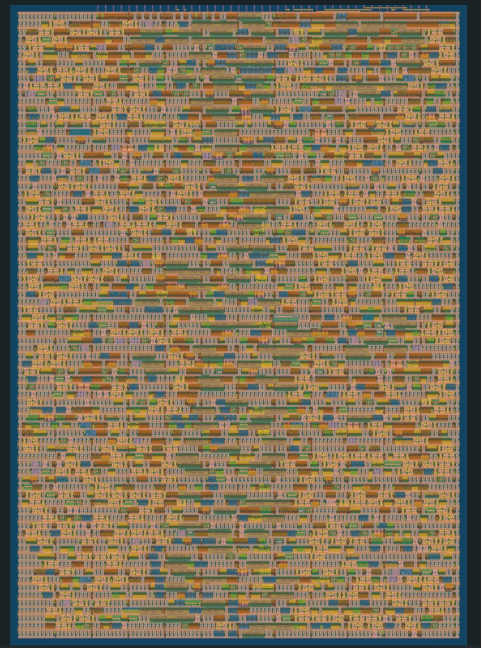

  

# K-Means Clustering AI/ML Hardware Accelerator (ASIC)

A dedicated, pipelined domain-specific hardware accelerator designed for real-time **K-Means Clustering** inference, taped out on the **SkyWater 130nm (`sky130`)** open-source CMOS process.

<p align="center">
  
  <br>
  <em>Physical GDSII layout generated via OpenLane / SkyWater 130nm (1x2 Tile: 167 µm × 216 µm).</em>
</p>

---

## 1. Project Overview

K-Means clustering is a cornerstone unsupervised machine learning algorithm widely used in real-time edge processing, image segmentation, and feature quantization. On conventional microcontrollers and CPUs, measuring multi-dimensional Euclidean distances to multiple centroids sequentially creates a compute bottleneck.

This custom ASIC implements a **spatially parallel streaming compute engine**:
* Concurrently evaluates squared Euclidean distances across cluster centroids.
* Utilizes a **4-stage arithmetic pipeline** to maximize clock frequency.
* Streams point assignments with **100% bit-accurate precision** compared against a Python reference model.

---

## 2. Hardware Architecture

```
                         Point Stream: (Px, Py)
                                   │
                  ┌────────────────┴────────────────┐
                  ▼                                 ▼
       [ Distance Engine 0 ]             [ Distance Engine 1 ]
       Target: Centroid (10, 10)         Target: Centroid (80, 80)
       - Stage 1: P - C                  - Stage 1: P - C
       - Stage 2: (diff)^2               - Stage 2: (diff)^2
       - Stage 3: Sum (X^2 + Y^2)        - Stage 3: Sum (X^2 + Y^2)
                  │                                 │
                  │ Dist0 [16:0]                    │ Dist1 [16:0]
                  └────────────────┬────────────────┘
                                   ▼
                         [ Comparator Stage ]
                        Cycle 4: (Dist0 <= Dist1)
                                   │
                                   ▼
                      cluster_out (0 or 1), valid_out
```

### Module Hierarchy
* **`pe.sv` (Processing Element):** 2-stage pipelined subtract-square element computing $(P_j - C_j)^2$.
* **`dist_unit.sv` (Distance Unit):** Aggregates dual PEs for 2D vectors and accumulates $(P_x - C_x)^2 + (P_y - C_y)^2$ in Cycle 3.
* **`kmeans_top.sv`:** Parallel instantiations for multi-cluster concurrent evaluation and Cycle 4 comparator.
* **`project.v`:** Top-level Tiny Tapeout ASIC wrapper mapping I/O pins and bus control.

---

## 3. Physical Design & Silicon Implementation

| Metric | Value |
| :--- | :--- |
| **PDK / Process Node** | SkyWater 130nm (`sky130_fd_sc_hd`) |
| **EDA Flow** | OpenLane / OpenROAD / Yosys |
| **Die Area** | 1x2 Tile ($167\,\mu\text{m} \times 216\,\mu\text{m} \approx 36,000\,\mu\text{m}^2$) |
| **Standard Cell Count** | ~2,573 logic cells |
| **Sequential Storage** | 171 Flip-Flops (balanced via Clock Tree Synthesis) |
| **Target Clock** | 50 MHz (20.0 ns period) |
| **Signoff Checks** | Passed DRC, LVS, Antenna, and Tiny Tapeout Precheck |

---

## 4. Verification & Testing

The design was verified across multiple verification abstraction layers:
1. **Behavioral Golden Reference:** Python integer model verifying distance boundaries.
2. **RTL Functional Simulation:** Icarus Verilog (`iverilog`) + GTKWave waveform analysis.
3. **Cocotb Test Suite:** Python-based hardware verification checking dynamic reset, valid strobes, and cluster boundaries.
4. **Gate-Level Simulation (GL):** Post-route verification simulating the synthesized standard-cell netlist with cell delays.

---

## 5. Pinout Configuration

| Pin Name | Direction | Function |
| :--- | :--- | :--- |
| `clk` | Input | System Clock (50 MHz) |
| `rst_n` | Input | Active-Low Synchronous Reset |
| `ena` | Input | Chip Enable Strobe |
| `ui_in[7:0]` | Input | Point X coordinate (`px_in`) signed 8-bit |
| `uio_in[7:0]` | Input | Point Y coordinate (`py_in`) signed 8-bit |
| `uo_out[0]` | Output | `cluster_out` (0 = Cluster 0, 1 = Cluster 1) |
| `uo_out[1]` | Output | `valid_out` (strobe indicating valid output) |
| `uo_out[7:2]` | Output | Lower 6 bits of distance metric for debug |

---

## 6. How to Run Locally

### Simulation
```bash
# Compile and run testbench with Icarus Verilog
iverilog -g2012 -o sim.vvp src/pe.sv src/dist_unit.sv src/kmeans_top.sv sim/tb_kmeans_top.sv
vvp sim.vvp

# Open waveforms in GTKWave
gtkwave kmeans_waves.vcd
```

### Synthesis (Yosys)
```bash
yosys -s synth/synth.ys
```

---

## License
Licensed under Apache 2.0.
